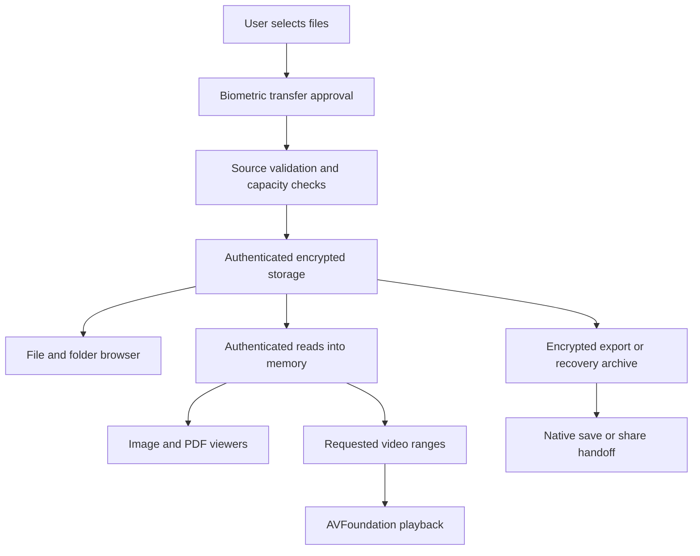

# Encra: architecture and design decisions

[Back to the project overview](README.md)

This high-level description summarizes the implementation and project documentation reviewed on November 7, 2026. It is a design discussion, not a source distribution or independent security audit.

## From import to private viewing

The diagram shows the main encrypted workflows. Explicit original-file export is a separate path that creates temporary plaintext for the user's chosen destination.

SwiftUI owns the interface, while an actor-based storage layer coordinates vault operations. Native framework bridges handle platform-specific viewing and file handoff. This separation gives storage policy a place to apply beyond individual buttons or screens.

## Protect more than file contents

Encrypted file bytes alone would leave other opportunities for disclosure. Encra also encrypts identifying metadata, folder names and relationships, file placement, and persisted thumbnail previews. On-disk object names are opaque identifiers.

The project uses CryptoKit authenticated encryption and separately derived keys for different storage purposes. Authentication allows altered data to be rejected. Thumbnail sidecars use fixed-size padding; file sizes and the number of stored objects are still observable to someone who can inspect the app container.

Folder moves update encrypted organizational metadata without rewriting large file containers. This connects the user-facing organizational model to a practical storage-cost decision.

## Vault identity and partial damage

An authenticated vault identity ties existing storage to its root key in Apple's data-protection Keychain. If that identity cannot be verified, operations stop rather than silently generating a replacement key.

Once global identity is verified, individual unreadable items can be isolated. Healthy items remain available, and the encrypted copy of a damaged item is retained for explicit review. This distinguishes a vault-wide identity problem from independent item damage.

## Bounded media and recovery workflows

New file containers use independently authenticated chunks. Video playback requests the byte ranges it needs through an Encra-owned resource loader, avoiding a plaintext movie file and whole-movie buffering. Image and PDF viewing uses in-memory plaintext, with admission limits governing which files receive previews.

Recovery exports use an independent generated code. They do not export the live vault's root key. Restore validates the archive before destination mutation, then streams and re-encrypts content under the destination vault's key.

Backups are manual. The user must retain both the archive and its separate recovery code; Encra does not automatically sync or retain those components for recovery.

## Case study: finishing a large export

**Problem:** preparing and verifying a large encrypted archive is only part of a successful export. Presenting the system save or share interface can introduce a separate memory cost if the presentation layer materializes the entire archive.

**Implementation decision:** Encra's iOS handoff passes existing file URLs to UIKit document-picker and activity controllers. The presentation layer references the prepared file instead of loading its bytes just to show a save or share panel.

**Why it matters:** the complete product workflow spans storage, progress reporting, cancellation, prepared-file ownership, and system presentation. A successful archive verification does not establish that the subsequent device handoff works reliably.

The URL-based handoff was confirmed in the implementation during preparation of this showcase. No fresh large-file device test was performed for this publication; see the [validation limits](VALIDATION.md).

## Security boundaries

- Import, export, backup, and restore require biometric approval. Browsing and viewing do not. Transfer approval is an application-level operation gate, not biometric access control on the Keychain item itself.
- Import leaves source files in their original locations. Neutral imported display names do not scrub metadata embedded in file contents.
- Explicit original-file exports create temporary unencrypted copies. Once a copy is saved or shared elsewhere, Encra does not control that destination.
- The inactive-scene privacy cover does not guarantee prevention of screenshots, screen recordings, or another camera filming the display.
- Encryption does not protect against a compromised app process or an attacker controlling an unlocked user session.
- Deletion is not a promise of forensic erasure, and releasing Swift or framework objects is not a guarantee of complete memory erasure.
- Device, app-data, or key loss can be unrecoverable without a valid manual backup and its code.

The project calls for dedicated review of formats, key lifecycle, recovery, caches, logging, and distribution settings, plus an independent security assessment before use with irreplaceable or high-risk material.
