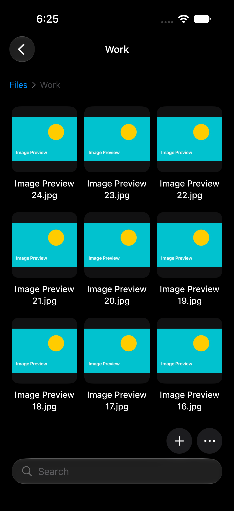
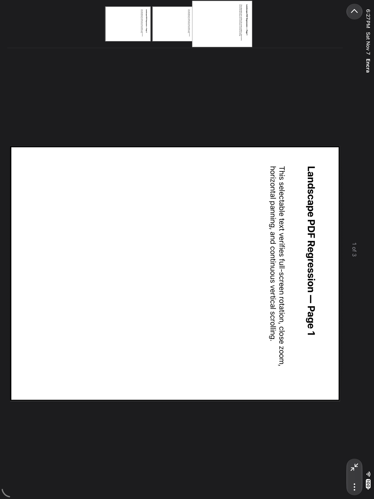

# Encra

**A native encrypted file vault for iPhone, iPad, and Mac.**

Encra brings file organization, private media viewing, and encrypted recovery into a native Apple-platform app. The product goal is to make everyday file workflows usable while treating storage, previews, exports, and recovery as explicit privacy boundaries.

This is the public showcase for an independent, closed-source project by **Andrew Baker**. Encra is in active development.

## Interface showcase

**Actual app screenshots with generated sample data.** These captures use fresh simulators and Encra's isolated test vault, with synthetic images and a generated PDF. No personal vault, private documents, or real recovery codes are shown. Each image was visually reviewed before publication.

<table>
<tr>
<th>File browsing on iPhone</th>
<th>Image viewing on iPhone</th>
</tr>
<tr>
<td></td>
<td></td>
</tr>
<tr>
<td>Folder navigation, thumbnail browsing, and compact search and file controls.</td>
<td>A focused viewing surface for a sample image, with navigation and document actions.</td>
</tr>
</table>

### PDF workspace on iPad

The PDF and its visible regression-test wording are generated fixtures. The page strip illustrates navigation within a document; it contains no personal or work records.

Captured November 7, 2026 on iPhone 18 Pro and iPad Pro 13-inch (M5) simulators running iOS/iPadOS 27.2. Select an image to inspect it at full size. These screenshots illustrate the interface, not an independent security assessment.

## Product focus

| Workflow | What Encra supports |
| --- | --- |
| Organize | Searchable files and nested folders, renaming, moves with Undo, and drag-and-drop organization on iPad and Mac. |
| View | In-app images, animated GIFs, PDFs, and private video playback. Other regular files can be stored as encrypted data. |
| Protect | Encrypted file contents, identifying metadata, folder structure, and stored thumbnail previews. |
| Transfer | Encrypted single-file and multi-file packages, compatible password-protected ZIP exports, and explicit original-file export. |
| Recover | Manual encrypted backups, archive verification, and additive restore using a separately retained recovery code. |
| Control exposure | A privacy cover when the app becomes inactive and biometric approval before import and export operations. |

Browsing and viewing do not prompt for Encra-specific biometric authentication. Original-file export deliberately creates a temporary unencrypted copy for saving or sharing. See the [security boundaries](ARCHITECTURE.md#security-boundaries) for these and other limits.

## Design and engineering

The project connects native interface design with the less visible work required to handle private files reliably:

- **Keep private storage private:** encrypt metadata and thumbnail sidecars as well as file contents.
- **Handle large files deliberately:** stream authenticated content and serve requested video ranges without creating a plaintext movie file.
- **Separate key loss from item damage:** verify vault identity before opening the library, then isolate independently unreadable items for explicit review.
- **Make recovery an understandable workflow:** prepare, verify, save, and restore an encrypted archive while keeping its recovery code separate.
- **Treat system handoff as part of the feature:** pass prepared export URLs to native iOS save/share controllers without loading an entire archive merely to present the panel.

[Explore the architecture and export case study](ARCHITECTURE.md) · [Read the validation summary](VALIDATION.md)

## My role

I define the product's behavior, specify workflows, and direct AI-assisted implementation and troubleshooting. My process is iterative: describe the intended experience, assess the resulting behavior, and refine the design and requirements.

Encra reflects my work in product direction, workflow specification, and iterative interface design. Implementation is heavily AI-assisted.

## Project technologies

Swift · SwiftUI · CryptoKit · Apple Keychain · LocalAuthentication · AVFoundation · ImageIO · Core Graphics · UIKit · Xcode

These are technologies used by the project. The shared application targets iPhone, iPad, and Mac, with platform-specific interaction and system integrations.

## Status and evidence

Encra remains in development. This showcase documents implemented workflows and selected historical validation records; it does not announce a public app release or claim an independent security assessment.

Automated checks cover storage, recovery, authorization, and interface behavior. Physical-device security scenarios and broader compatibility testing remain separate work. The [validation summary](VALIDATION.md) distinguishes recorded results from checks that are still outstanding.

## Source availability

Encra is closed source. This repository contains public project documentation and reviewed sample-data interface screenshots. Application source, private development history, test-fixture source, and internal reports are maintained separately.

## About the creator

Created by **Andrew Baker**.

[LinkedIn](https://www.linkedin.com/in/andrew-baker-gis/) · [GitHub](https://github.com/AndrewBaker-png)
